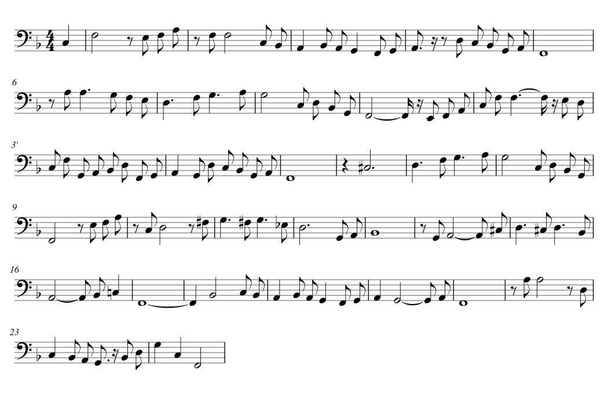

# Träumerei, hummed

Alfred Grünfeld's 1905 Welte-Mignon recording of Schumann's _Träumerei_ (WM 225), played from the
roll's reconstruction (`/mpm/`), with the inner voice of a pianist humming along: rendered live in
the browser by VocalTractLab, at any degree of elaboration: from the humming alone, its gestures
raw and exaggerated, to the piece itself as the reconstruction sets it down, the humming under it.

<https://welte225.org/>: the site's front page. The page is the repository's root `index.html`;
it loads everything else from here (`<base href="/hummed/">`), and `/hummed/` itself sends
visitors on to it.

The page shows the hum's spectrogram filling the window, in red, scrolling under a playhead, and
under it the piano's in a blue grey (below). Over it, on
the left, one fader, elaboration, which sets what is heard and how refined it is (below); on the
right, the transport. Moving it renders the voice anew and takes it over at the same place in the
score. The page is titled as the reconstruction is: the comment in the MPM's metadata, read
from `/mpm/performance.mpm` (`src/shared/mpm.ts`; the HTML carries the same text for readers
without scripts and for link previews, and a test keeps the two equal). A small info button opens
a card with that title, the author, the year and the DOI (a placeholder until one is minted), links
to the overview of the site's projects (`/overview/`) and to the source, and the credits; small
info button beside Elaboration explains it. A gear beside the info button opens the settings: which
piano plays (below). The cards are native popovers: closed until asked for, and closed again by
Escape or a click anywhere else.

The strip is drawn at most once in an animation frame, and in every frame while the playhead moves
(`src/page/redraws.ts`); never while the page is hidden. A frame is drawn only if it would look
different (`frame.ts`): the strip has scrolled, columns have come within the stretch in view, or
the piano is shown otherwise. The transport reads its position from the audio clock, which the page
sees advance a buffer of the sound card at a time (9 to 20 ms from frame to frame where a frame
takes 16.7); the playhead is drawn carried on by the frames' own times and only gently towards the
clock (`glide.ts`), and exactly where the transport is when it rests. Drawing may take half of the
main thread's time: with a graphics card that is every frame (half a millisecond each); where the
browser rasterizes the canvas itself (headless Chromium: 5 ms a frame at 1280 × 720), frames are
left out evenly, down to 20 a second. A worker's message is written into the spectrogram's tiles in
one piece (`strip.ts`), and the readout only where it changes (`readout.ts`): the slider, while it
plays, when its thumb would move by a pixel. (Drawn anew for every message and every tick of the
transport, the same picture was drawn up to 39 times in a frame while the voice streamed in, and
moved 20 times a second while it played.)

The spectrogram comes in two styles (`src/shared/spectrogram.ts`): the full one (70 Hz to 4.5 kHz,
in decibels), and the melodic range after Sonic Visualiser's "Melodic Range Spectrogram" (40 Hz to
1.5 kHz, an 8192-sample window, in linear amplitude, so the sung line and its octave stand out
and the rest falls away). The page shows the melodic range; `?spectrogram=full` shows the full one.

A column costs little: the worker transforms only what the rows read (`src/worker/fft.ts`). The
8192 samples under the window go in pairs through a complex FFT of half the size, which stops at
blocks of 512 bins (the melodic range reads the lowest 280 of 4097), and each bin wanted is summed
from the eight blocks directly. A magnitude is taken once for every bin, and the greys of the
decibel scale and of the piano's come from a table that leaves the levels at which a grey changes
to the formula (`src/worker/greys.ts`). The pixels are those of a plain FFT over all bins with the
formulas applied to every row: over the whole piece in both styles and a recording of the piano at
48 kHz, not one of 17.9 million differs. A column takes 0.06 ms where it took 0.42 ms.

Under the humming the page draws the piano, the part the elaboration lets be heard: the harmonies
below the middle, as faint as they are quiet, the piece from the middle on, nothing while the
humming is alone. It is the spectrogram of the sound that plays: the Pianoteq recording of the
setting, or the sampled grand, which plays the part ahead of time for it (an `OfflineAudioContext`;
an instrument over MIDI has no sound in the page, so the page's own piano stands for it). A worker
of its own draws it (`src/page/piano-picture.ts`, `src/worker/picture.ts`), from the playhead on,
in the same rows as the voice, in the melodic range as the amplitude to the power of 0.7, so that
a key is seen while it sounds and not at its strike alone. The humming is drawn over it, so where
both sound the humming is what is seen. The settings switch the piano's picture off.

The settings also show the reconstruction's instructions (`src/shared/instructions.ts`,
`src/page/instructions-view.ts`): a panel at the top left that lists, for the moment at the
playhead, the calls of `/mpm/work.json` that hold there, by dimension: tempo, rubato, dynamics,
accents, articulation, arpeggio, pedal. Each is named by what it wrote into the MPM (a tempo's
course in beats a minute, a dynamics curve from where it begins to where it arrives, a pattern
with its scale) and is a link that opens MPM Desk's viewer at that call
(`https://mpmdesk.welte225.org/#<id>`, where `https://welte225.org/mpm/<id>` sends on to), pausing
the page. A call holds over the range the work file gives it, and is listed for 1.2 s at least,
so that an arpeggio, which is one moment of the score, can be read and clicked. A pedal's press
holds for as long as the pedal stays down, up to the call that lifts it. The calls without a
range (the choice of the take, the velocity mapping, the stylization of the ornaments, the merged
patterns, the grace notes, the metadata) are of no moment in particular and are not listed. Both
choices are remembered between visits; the instructions are off until asked for.

## What is hummed: a reduction for a pianist's voice

A pianist humming along is no singer: about an octave, low, and a breath wherever the line changes
hands. `reduction/reduction.mei` is what is hummed, written as its own MEI: one bass staff,
114 notes from E2 to A3 (mostly F2 to G3), each pointing with `@corresp` to the note of
`/mpm/transcription.mei` it comes from (the repeat's notes as `…-rend2`). That is how the
performance reaches it: a sung note takes its onset and dynamics from that piano note and, where
it is the whole written note, the piano's release too. The page reads the MEI itself; edit it and
reload.



The draft (`reduction/draft.py`) is a list of choices read from the score and from Grünfeld's
playing: which voice to follow from where, an octave shift where the range needs it, sung pedal
notes where the harmony holds still, rests to breathe, and air in two places.

- **A (1–8):** the opening motif an octave down; the tenor's answer (2–3); the bass walk Grünfeld
  leans on (4); F2 held under the restarting melody (5); A3 (6); the tenor's rise D3 F3 G3 A3 (7);
  the bass (8).
- **A repeated (1′–8′):** the melody itself, two octaves down (1′–3′); the bass; F2; in 6′, under the
  climb to A5, the voice is silent; then as in 7–8.
- **B (9–16):** F2, then the melody at mf; the tenor C3 D3 F♯3 G3 … (10–12); a short breath out
  through the teeth at the quiet turn in 12; B♭2 over Grünfeld's low B♭1 (13); A2 under the climax
  (14); D3 C♯3 D3 (15); the ritardando A2 B♭2 C3 (16).
- **A and the close (17–24):** as before, with F2 pedal notes; silent through the fermata (22); the
  last F2, then a breath out through lips and teeth as the chord fades.

What the MEI says, and how the voice reads it:

- **Breaths** are rests with `@type="breath"` (and a `<breath>` for the eye): 29 of them. Where the
  voice changes without a written rest, the draft cut the note before by about 0.45 s at
  Grünfeld's tempo there (a sixteenth at least), and no stretch runs over 8 s without a breath (the
  longest is 7.9 s). Because a rest is a score position, the tempo times it: a breath in a slower
  passage lasts longer. The dynamics set its depth: a deeper, audible intake before a louder
  stretch. Beyond these the voice breathes on its own, as an amateur does, more often
  (`takeBreaths`, `src/hummer/melody.ts`), but only where the performance leaves room: where the
  piano leaves a gap of 140 ms or more before the next key, or lifts the pedal at the end of a note
  of a second or more, and no sooner than 2.5 s after the last breath. That adds 9 breaths, 38 in
  all; the note before such a breath ends a quarter of its length early (0.15 to 0.35 s).
- **Pedal notes** (`@type="pedal"`) are held to their written end, not to the piano key's release.
- **Air** is written as x noteheads, `@type` `air-teeth` or `air-lips`. It is breathed out as a
  sigh through the nose (`AIR_OUT`, `src/hummer/gestures.ts`): the lips stay closed and the velum
  low, as in the hum; the glottis opens early by its lag, so that the sigh starts voiceless; the
  lungs push for 60 ms and let go within 0.45 s, however long the air is written. Above 200 Hz,
  where breath is heard, it lies 20 to 35 dB under the hum around it. Written as a hiss at the
  teeth or the lips (an s, an f), with the lips bursting open from the hum, it sounded comical;
  as a longer, stronger sigh it still sounded like a bus's hydraulics; long passages of air (3–4 s,
  in 6′ and over the fermata) were taken out.
- Ties join notes; a plain rest after another rest extends it; `<beam>` is looked through. A chord
  or a tuplet is refused: the voice sings one note at a time.

After changing the reduction, run `npm run calibrate` (below) so the new notes are as loud as the
dynamics ask; until then they sound uncorrected, which is close.

## Elaboration: the humming, the harmonies, the piece

`reduction/harmonies.mei` is a harmonic reduction of the piece: its chords, with the repeat
written out, each where the piece sounds it. Drafted to a steady pulse of half notes, it had moved
many of them off their beats; they are back (the repeat as the first time):

- on the second beat where the harmony changes there: the B♭ of bars 2 and 18, the C7 of 3, 19,
  23 and 24, the C of 4 and 20, the A7 of 6, the D7 of 10, the A7 of 14, the G of 22, the chord
  before sounding until then, tied over the bar line where it has to be;
- the C minor of 10 and the G minor of 14 on the second eighth of those bars, no longer in the
  second half of 9 and 13;
- a chord that moves on within its harmony where the piece moves: mostly on the last eighth, in 6
  an eighth after the third beat, in 16 on the fourth;
- the appoggiaturas of 10, 14 and 22, once grace notes, written out: the top of the chord on the
  second beat, resolving where Grünfeld resolves them.

espressivo converts it to a score (MSM) as it converted the piece's; grace notes, which the
converter leaves out and reports beside the score, the worker would put back, a thirty-second each,
the last just before the note they lead to (`src/worker/harmonies.ts`; none are written at
present). It performs the score with the same MPM
as the roll, exaggerated as much. Tempo, rubato, dynamics, arpeggios and pedalling apply to the
harmonies as to the piece: the harmonies strike only where the piece strikes, so where the piece
rolls a chord, theirs is rolled too, and notes that no arpeggio moves start on the same millisecond
as the piece's. What the MPM says of single notes of the piece (articulation by note) finds nothing
to apply to.

The elaboration fader (`src/page/mix.ts`) sets three gains, from left to right:

- At 0, the humming alone, at full level.
- Rising, the harmonies come in from silence under it and grow soon, as the square root of the way
  up, to the piano's level (−5 dB) at the middle: 7 dB under it a tenth of the way up, 3 dB a
  quarter of the way.
- From the middle on, the piano plays the piece instead, at the same level.

The humming falls soon too, as the square root of the way up, from 0 dB to −11 dB a quarter of the
way, −15.6 dB at the middle and −22 dB at the top, where it is a pianist humming along. The page plays both the piece and the harmonies all
the time, each into its own gain, so passing the middle crossfades between them, even in the
middle of a chord. It starts at 0.65: the piece, with the humming at −17.7 dB. (The harmonies came in as the square
of the way up and the humming fell evenly in decibels; both changed too late.)

The fader also sets how exaggerated the performance is, and so the voice itself
(`src/worker/levels.ts`): elaboration in the sense of making things subtle. The barer the music,
the rawer its gestures; the more of it there is, the more refined, until at 1 the piano plays
Grünfeld's performance as the MPM sets it down, with all its editorial decisions. espressivo
exaggerates the MPM (`exaggerateMpm`) to:

- the piano: `1 + 0.4 (1 − e)²`, ×1.4 at 0, ×1.1 at the middle, ×1.05 at 0.65, ×1 at 1;
- the voice: `1.1 + 0.3 (1 − e)²`, ×1.4 alone, ×1.14 at 0.65, ×1.1 under the piece, a little beyond
  the piano except in timing.

(×2 at 0 sounded extremely unnatural, ×1.6 still too much.)

The voice also keeps more loosely to the pitch the barer the music: its approximateness, 1 at 0
and 0 at 1 (below). Moving the fader renders the voice anew once it rests, in steps of 0.05; the
gains change at once.

## How the voice hums

For one elaboration a worker (`src/worker/worker.ts`) does this:

1. **The performance.** espressivo (`exaggerateMpm`, `performMsmToData`) performs the MPM twice:
   for the piano at its level, and for the voice at its own. The voice is the inner guide of the
   playing: a little more exaggerated than the piano, except in the dimensions that move
   notes in time (tempo, tempo shape, rubato, asynchrony, arpeggio spread and spacing, timing
   imprecision), which it shares with the piano, so the two keep the same onsets to the
   millisecond. A third rendering, with sub-note dynamics, gives the dynamics as a curve.
2. **The voice's decisions** (`src/hummer/vocal-map.ts`): a breath at each breath rest and each
   breath taken, sized by the dynamics; a scoop into each phrase and a slight sag at its end (0.3 to
   0.8 semitones, scaled by 0.75 to 1.25 with the approximateness); between notes, what Grünfeld's
   fingers do: where the keys overlap by more than 30 ms the voice slides over half the overlap,
   within 15 ms it sings legato, a gap of 15–110 ms (or a repeated pitch) becomes a breath pulse,
   from 110 ms it stops, the lips closing before the note where they were open; a note that came
   out of a spread chord slides up from the chord's first note. The touch is also said with the
   tongue (`ARTICULATION.consonants`): a portato or a repeated note begins with an "n", the tip
   at the ridge behind the teeth for 80 ms while the hum goes on through the nose; a detached
   note with a "d", the same closure (at most 80 ms) with the velum shut, so that the voice falls
   silent and is released on the note, the lungs pushing again for 50 ms behind the tongue. The
   mouth opens rarely and slowly, and to an "a": where the dynamics smoothed over ±1.5 s pass 46
   on the roll's scale (fully at 49), over 3 to 4.5 s so as to be open at the peak, and it closes
   over 3.5 s once the dynamics have fallen back, both eased, so that the lips have no speed where
   they begin to move and where they stop: at the page's start in 2 places (bars 9–10 and 13–14),
   with the humming alone in 3 (bars 19–20 too). The tongue goes first: from 1.2 s before the
   lips begin, behind them, to where the speaker's "a" has it (with the jaw and the hyoid; moved
   in the tract states, `TONGUE_A` in `src/hummer/articulators.ts`), and it is there while the
   lips are still all but closed; it leaves when they are all but closed again. Then the lips
   part, barely (the shape `ah`: that "a" with the lips 0.35 cm apart, not 1), and the nose
   closes as they do: the lips-open score has the velum shut. (The open shapes fitted to the
   recorded hum went half of the way from the hum's forward tongue to an "a", with the nose
   open: a nasal vowel between "ö" and "ä", with a resonance at 1.4 kHz, which bleated like a
   goat; and the lips parted on the hum's tongue. Before that, from 44, over 1 to 2 s at an even
   pace and closing with each phrase, the lips parted in 4 to 7 places and were heard to part;
   from 37.5 the mouth was open for a third of the piece.) The humming shape
   changes with each phrase, at pedal presses and in long notes. These decisions (the mouth, the depth of breaths and air)
   read the dynamics against the MPM's own range: its 10th to 90th percentile (19 to 32 in the
   reconstruction) is mapped onto the roll's (34 to 44), for which their thresholds were set, so
   the voice opens and breathes deeply in the piece's louder moments however soft its pianissimo.
   The glottis and the lungs follow the dynamics as they are: with the reconstruction's soft
   playing the voice stays breathy almost throughout (its folds half closed or more for under 2 s
   of the piece).

   The voice is heard where the performance moves (`src/hummer/presence.ts`). A pianist humming
   along sings the whole line inwardly; what comes out is what the playing does. At every moment
   of a sung note the voice asks how much the MPM's maps that govern it are moving, and takes the
   most of three: the dynamics changing, either way (6 units a second count as 1); the tempo
   changing, rubato and all, read from how fast score time passes (by 40 % of itself a second);
   an accent, a note above the dynamics curve in velocity (by 2), for 0.2 s after the note begins
   and then fading (450 ms). Change is read over half a second. From a movement of 0.6 on, all of
   the voice is heard (`THRESHOLD`: the dynamics at 3.6 units a second, the tempo changing by a
   quarter of itself); below a quarter of that, nothing; between, softly more. It begins to come
   0.2 s ahead and comes and goes through two lags, in over some 0.8 s and out over 1.1 s, so it
   does not set in: it swells with a hairpin or a turn of the tempo and sinks back where the
   playing holds still, in the tails of long notes and through even passages. The lung pressure
   follows (`FADE`, `src/hummer/gestures.ts`), falling evenly in decibels, 30 dB from the voice
   as it is down to nothing, the glottis as the dynamics have it: at half of the voice the sound
   lies some 17 dB under it. The threshold is the same at every elaboration; the barer the music,
   the more exaggerated the MPM and the more its maps move. Alone, the voice is heard (more than
   half of it) for 73 % of what it sings, at 0.65 for 64 %, under the piece as it is for 62 %;
   the breath before a phrase that begins unheard is drawn at 0.4 of its pressure.

   (Before, the voice sounded through every phrase at an even level and fell silent only in the
   tails of long, still notes, 6 to 11 times in the piece, dying away over 0.8 s and back within
   0.2 s. A first version of this one measured not movement but intensity, the dynamics' level
   and an impulse for every note, against a high threshold, and tired while it sounded: the voice
   was heard for a fifth of what it sang, far too little; and it came up with the folds swinging
   less while the lungs went on pushing, which sounded like a flute.) The calibration renders the
   voice whole (no threshold).

3. **Gestures** (`src/hummer/gestures.ts`): the pitch line; the effort, lung
   pressure following the dynamics within held notes (velocity^1.5, each note offset by its own
   velocity against the curve, corrected by the calibration) and the glottis from breathy to modal
   with loudness, the lungs pushing less where less of the voice is heard; two gestural scores,
   lips closed and lips open at their widest (`src/hummer/gestural-score.ts`), and the opening
   that blends them, eased from one amount to the next.
   The consonants are not gestures of the score: VocalTractLab sets a consonant's whole vocal
   tract to that of a prototype syllable, so jaw and lips would open for every "n" and "d", which
   made them all sound like "mä". Instead the tongue tip alone is moved, in the tract states
   VocalTractLab computes from the scores, to the speaker's alveolar closure in the /u/ context,
   easing in over 25 ms and out over 30 ms (`src/hummer/articulators.ts`,
   `src/worker/voice-states.ts`); jaw, lips and tongue body stay as the hum has them. Closures
   further back ("g", "ng") were tried on synthetic phrases and did not sound like themselves;
   they are not used.
4. **Sound** (`src/vtl/engine.ts`): VocalTractLab in WebAssembly turns both scores into tract
   states, and the tract states into sound, 110 samples (2.5 ms) at a time. The tube geometry is
   computed every 10 ms and only where the tract has moved by more than 0.03, and interpolated in
   between (0.03 dB from computing it every step, in the median); the closed and open tubes are
   blended by the opening, so the lips part gradually rather than with VocalTractLab's jump.

The pitch line holds every target still. VocalTractLab moves the pitch towards a target as a
fifth-order critically damped system that follows a sloped target exactly and then carries its
speed past the end of the slope: the slides and scoops that were written as slopes overshot the
next note by one to two semitones. A target that holds still cannot be overshot. Such a change is
half done 4.67 time constants (140 ms at 30 ms) after the target changes, which had put every new
pitch some 0.12 s behind the piano; each target now takes over that much earlier, so the pitch is
half way when the note is heard (or in the middle of a slide), plus a little that grows with the
approximateness. The dips of breath at pulses and stops are moved earlier by their own lag in the
same way (56 ms for the lungs), so that they land on the note. Within a note:

- A note led by a breath starts below its pitch: the scoop, held low, then let go.
- The note lands off its pitch by a random amount (sd 10 to 40 cents) and after 160 to 280 ms
  settles to a third of that, never quite on it.
- About it the pitch wobbles, a new random target every 125 to 200 ms (the measured 29 cents,
  scaled by 0.85 to 1.35), and a phrase's last note sags a little.

Each range runs from approximateness 0 to 1, and the time constant from 30 to 40 ms (VocalTractLab
allows at most 40). At 0.65, 300 ms into a note, the pitch is 12 cents off its note in the median
(27 at the 90th percentile), and half way to a new note 28 ms after it sounds. At 0 these are 26
cents (68) and 59 ms, at 1 8 cents (21) and 11 ms.

The page runs several such workers side by side (`src/page/pool.ts`; as many as there are cores
to spare, at most four); each loads VocalTractLab and the data as soon as it is there. The first
prepares a setting with the help of the next two, over channels of their own
(`src/shared/protocol.ts`): one performs the piano's two parts, which the plan needs and the voice
does not; the other performs the voice's dynamics while the first performs its notes, and turns the
lips-open gestural score into tract states while the first turns the lips-closed one
(`src/worker/prepare.ts`). With one helper it plays the piano and takes the open score; a worker
alone does it all. The first answers with the plan and goes straight on to the chunk that will be
heard first; once that chunk's first half second is out it hands a copy of what it prepared (the
tract states, some 27 MB) to each worker that has not got it, so that none prepares what another
has, and it keeps the last three settings it prepared: going back to one needs no preparation.

The voice is rendered in chunks (`src/worker/chunk.ts`): it is cut where it is silent, 250 ms after
the lungs have stopped pushing air, when it is some 100 dB down, so the chunks join without a seam.
They are handed out in the order they will be heard, from where playback is to the end and then
from the beginning, each worker getting its next a little before it finishes the one it is on, and
streamed to the page in blocks with their spectrogram columns, a chunk's first half second of sound
before any column. The piano's recordings of a setting are fetched and decoded while its voice is
prepared, and a change of setting while playing starts the new voice as far ahead of the playhead
as the last changes took to be ready (0.4 to 1.2 s).

Of the work, VocalTractLab's acoustics take six sevenths and its geometry a tenth; the spectrogram
adds a fortieth. One worker renders the voice 4.4 times as fast as it plays (in Node, on one core
of a cloud server: `npm run bench`), where it was 2.7 times; in Chromium on that server's four
cores, three workers render it 11.7 times as fast (the whole piece in 15 s, where it took 26),
and one 4.5 times (2.7). The page can play 0.95 s after it asks for its first setting (1.65 s),
a setting changed while playing takes over after 1.1 s (1.8 s), and one gone back to after 0.6 s
(1.2 s). The page (`src/page/`) plays the
voice as it arrives, hands the roll and its harmonies, from the same performance, to the piano
chosen (below), and sends all into one small room: early reflections and a
stereo tail whose highs die sooner than its lows (1.6 s in the bass, 0.6 s in the treble), the
voice a little further in than the piano and after a 20 ms pre-delay.

espressivo 0.11, strongly exaggerated (from about ×1.8), leaves a few arpeggiated notes with
impossible times: an onset equal to the note's tick position or tens of seconds past the end, or
an end before the onset. `repair` (`src/hummer/performance.ts`) puts such a note back at the head
of its chord, and gives a note that ends too early a length, before the piano or the voice uses it.

## The piano

The worker sends the piano with every plan as the roll plays it: each part's keys with their own
releases, its sustain pedal and its soft pedal (`src/worker/piano.ts`, `src/shared/piano.ts`). The
settings offer three ways to sound it (`src/page/settings.ts`, `outputs.ts`, `midi.ts`):

- **The Bösendorfer 280VC as Pianoteq rendered it ahead**, where there are recordings in
  `piano/pianoteq/`: both parts at each setting of the elaboration the voice is rendered for
  (every 0.05, the piano as exaggerated as that setting has it), mono MP3s listed in
  `manifest.json`. A setting is loaded when it is asked for, and the page keeps the one playing and
  the one coming. A setting that was not rendered, or whose recording is not of the performance as
  it is (its keys counted against the manifest), is played by the sampled grand. Where there are
  recordings they play, unless the visitor chose the sampled grand on an earlier visit.
- **The Salamander grand, sampled as you listen** (`src/page/piano.ts`): each key held while the
  sustain pedal is down, at least 0.3 s. The page loads it only when it plays.
- **The visitor's own instrument over MIDI** (Web MIDI: Chrome, Edge and Firefox, which ask
  first): a Disklavier, or Pianoteq or another program listening on a MIDI port. It plays the part
  the elaboration lets be heard (none while the humming is alone): the keys, the sustain pedal
  with the MPM's positions between up and down (controller 64) and the soft pedal (67), each message timed for when its sound is to be heard. The instrument's delay, which
  the visitor gives (a Disklavier waits about half a second), is sent that much earlier, and the
  voice starts that much later. A key pressed again while it still sounds is let up just before,
  and two presses of a key at one time (eighteen in the piece, where the score doubles a note) are one.
  On a pause the instrument is silenced. What was already sent for later is cancelled where the
  browser can; where it cannot, the keys that would still go down are let up again after the last
  of them. The page's room does not reach the instrument.

`npm run pianoteq` makes the recordings (`tools/pianoteq.ts`). For each setting it writes both parts
as MIDI files, the messages an instrument would be sent (`tools/smf.ts`, a tick of half a
millisecond), and has Pianoteq render them (`--headless --midi … --wav …`, with the preset given,
its reverb off: the page has its own room). It finds where the sound lies against the messages by
the strikes of the keys (`tools/audio.ts`: the rise in the energy of the sound's first difference,
millisecond by millisecond, against the keys' times weighted by their velocities, refined to a
tenth of a millisecond; a stand-in renderer's 37.3 ms came out at 36.9 to 37.4) and moves it into
place, and reports a lag that changes from the beginning to the end. All settings get one gain: the
piece at ×1 (the elaboration 1) as loud as the sampled grand plays it (−20.4 dB, measured in
Chromium), and no recording above −0.5 dBFS. Chromium decodes the MP3s without moving them (it takes the encoder's
delay out), as measured against the messages; other browsers were not measured.

The manifest records each part's keys and the fingerprint of its messages, and
`test/recordings.test.ts` compares them with the performance as it is: after a change to the
reconstruction, the harmonies or the chain, CI fails until the recordings are rendered again.

## Code

| Path                             | What it is                                                                                                                                                                                                                                                                  |
| -------------------------------- | --------------------------------------------------------------------------------------------------------------------------------------------------------------------------------------------------------------------------------------------------------------------------- |
| `../index.html`, `style.css`     | the page (the site's front page) and its styles                                                                                                                                                                                                                             |
| `app.js`, `worker.js` (+ `.map`) | the page's and the worker's bundles, built from `src/` and committed, since GitHub Pages serves the repository as it is                                                                                                                                                     |
| `vtl.js`                         | VocalTractLab compiled to WebAssembly (`vtl/build.sh`), committed likewise                                                                                                                                                                                                  |
| `src/reduction/`                 | reading the reduction's MEI                                                                                                                                                                                                                                                 |
| `src/hummer/`                    | from a performance and the reduction to the two gestural scores                                                                                                                                                                                                             |
| `src/vtl/`                       | VocalTractLab's module, typed, and the streaming engine around it                                                                                                                                                                                                           |
| `src/worker/`                    | the worker: levels, the harmonies' score, the piano's parts, a setting's preparation, a chunk's rendering, spectrogram, the piano's picture                                                                                                                                 |
| `src/page/`                      | the page: audio graph and room, the elaboration mix, the pianos (sampler, recordings, MIDI) and their settings, renderings, the workers' pool, transport, spectrogram view and when it is drawn (redraws, frame, glide), the readout, the piano's picture, the instructions |
| `src/shared/`                    | what both sides use: units, maths, the messages between them, the order of the chunks, the piano's parts and their MIDI messages, the recordings' manifest, the reconstruction's calls as instructions                                                                      |
| `data/`                          | the speaker (VocalTractLab's JD3 with 66 mouth shapes fitted to a recorded hum, mixes of three, the open shape `ah`, and glottis shapes from breathy to modal, `g00` to `g20`), the hum style measured from it, the calibration                                             |
| `piano/`                         | Salamander Grand Piano samples, a minor third apart, at four velocities, mono, 7 s; in `pianoteq/`, the Pianoteq recordings and their manifest                                                                                                                              |
| `reduction/`                     | what is hummed (`reduction.mei`), its rendering, the script that drafted it, and the harmonies (`harmonies.mei`)                                                                                                                                                            |
| `tools/`                         | build, calibration, a benchmark, the Pianoteq recordings, a browser smoke test, and what they share for running in Node                                                                                                                                                     |
| `test/`                          | unit tests, the voice against its fingerprint, VocalTractLab in Node                                                                                                                                                                                                        |
| `vtl/`                           | the VocalTractLab build and its patch                                                                                                                                                                                                                                       |
| `research/`                      | how it came to be: the report, the offline pipeline, the first renderings                                                                                                                                                                                                   |

The score and the performance are the site's own (`/mpm/score.msm`, `/mpm/performance.mpm`), so
the voice follows the reconstruction as it is published. The piece's grace notes are in the
performance, not the score: MPM Desk writes each group as an MPM v3 ornament on the note it leads
to, timed as the roll plays it, and espressivo plays the figure in that note's place — the bass's
B♭–F of bars 3 and 19 with the F struck early and held, as Grünfeld does.

## Development

Node 22.18 or later runs the TypeScript directly; nothing is compiled but the two bundles.

```sh
npm ci
npm run check        # types (tsc, strict), lint (typescript-eslint, strict, type-aware), format, tests
npm run build        # app.js and worker.js
npm run bench        # the voice in Node as a worker renders it: where the time goes, fingerprints of sound and picture
npm run calibrate    # after changing the reduction, the hum style or the reconstruction
npm run smoke        # the page in Chromium (needs Playwright installed): plays, switches, seeks, info, instructions, pianos
npm run pianoteq -- render --pianoteq <Pianoteq's program> --preset <name>   # the recordings (above)
npm run pianoteq -- midi --out <dir>   # only the MIDI files of every setting
```

`npm run pianoteq` needs Pianoteq (the program itself, e.g. on a Mac `/Applications/Pianoteq
9/Pianoteq 9.app/Contents/MacOS/Pianoteq 9`, or in `PIANOTEQ`) and ffmpeg. `--step 0.1` renders every other setting only (the sampled grand plays those between),
`--elaborations 1,0.65` renders only those (the others in the manifest stay), `--fxp` takes a
preset file instead, and `--instrument` and `--credit` name the instrument on the page.

Serve the repository root (`python3 -m http.server`) and open `/`: the page loads `/hummed/` and
`/mpm/`.

`test/voice.test.ts` holds the voice to a fingerprint (`test/golden.json`), taken when the
TypeScript was shown to produce gestural scores byte for byte identical to the JavaScript it
replaced, and `test/engine.test.ts` holds six seconds of VocalTractLab's sound to another; after an
intended change to what the voice does, `UPDATE_GOLDEN=1 npm test`. `test/spectrogram.test.ts`
holds the columns of a synthetic swell, in both styles and at 48 kHz on the piano's scale, to
fingerprints taken from the first, plain implementation; `test/fft.test.ts` holds the transform to
a naive DFT and `test/greys.test.ts` the table of greys to the formula. CI
(`.github/workflows/hummed.yml`) runs the checks on every change to `hummed/` or `mpm/`, and fails
if the committed bundles are not what the sources build to.

`npm run calibrate` renders the voice at the page's first elaboration in Node, measures each sung note's level against what
the dynamics ask, and writes per-note corrections (by `xml:id`) and the output gain to
`data/calibration.json`; two rounds bring the notes within 0.01 dB of the dynamics.

`npm run bench` renders a setting in Node with the worker's own modules (`--elaboration`, 0.65 if
none is given; `--seconds 20` for the chunks that begin in the first 20 s only; `--vtl <file>` for
another build of VocalTractLab) and prints the preparation's parts, the time to the first half
second of sound, where the rendering's time goes, its speed against real time, and the SHA-256 of
all the samples and of all the spectrogram's pixels: a faster build has to print the same two.
`--audio <file>` writes the samples, to compare two builds one by one.

`vtl/build.sh` rebuilds `vtl.js` (Emscripten 3.1.6): VocalTractLab 2.4.2 with
`vtl/vocaltractlab.patch`, which raises the gestural model's limit from 60 s to 240 s (in one pass
over the whole piece every parameter froze after a minute) and adds `vtlGesturalScoreToStates`,
which returns a score's tract states in memory.

The patch also makes VocalTractLab faster without changing its output by a bit: the acoustic
simulation twice as fast as it came, the geometry twice, the gestural model eight times. Every
arithmetic operation that remains is the one VocalTractLab does, on the same values; what the
patch changes is marked "Speed (same results)" in the code. In the acoustics it keeps from one
sample to the next whatever has not changed:

- a tube section's resistances and inductances while its shape stays;
- while the tract holds still (six sevenths of the samples), all that follows from the tube alone,
  for each of a step's 110 samples: VocalTractLab interpolates between the step's two tubes for
  every sample, and between two equal tubes the result still flickers in its last bit from sample
  to sample, but it is the same at the same sample of every such step;
- the factorization of the trachea's rows of the network's matrix;
- the glottis's sine table, the noise filters, the noise sources that are off.

Each time step's equations are solved column by column instead of row by row (every entry gets the
same products subtracted in the same order), with the matrix's rows assembled just ahead of the
factorization and the currents and pressures updated just behind the back substitution, so that
the processor has work beside the two long chains of dependent divisions and square roots that the
solution is; quotients that do not depend on each other are divided two at a time. The patch
leaves out the products of the factorization that are zero, and compares numbers inline where
WebAssembly would call `memcmp`.

In the geometry (a tube from the tract's 19 parameters: 165 cuts through the surfaces of the
tract) each triangle is cut once per line, not once for every tile of the surface's grid that
names it; a triangle wholly on one side of the line is left after its three corners are tested;
the marks of what has been tested are numbered per line, not cleared in every corner and edge for
each line; and the 2048 cuts a cross-section can hold are not zeroed before each. In the gestural
model the gestures of a score are read in one pass (asking for the n-th counted from the first
every time), the curves are calculated once, not twice, those with the same timing together, plain
decimals are read without `strtod`, and the score's memory is kept between calls.

The sound's fingerprint in the tests was taken with the build before any of these changes. The
whole piece at the elaborations 0, 0.65 and 1 was compared with that build's by the fingerprints
of all its samples (`npm run bench`), as were the tract states and every tube.

`VTL_FLAGS=-DTDS_REORDERED_SOLVER vtl/build.sh` builds a solver that is not the same to the bit:
it eliminates the network's currents in rounds of currents that do not depend on each other (every
other one along a run of tube sections), which takes the two chains apart; the acoustics are a
fifth faster again (the whole piece 5.4 times as fast as it plays on one core, not 4.4). The
solution is the same but for rounding: over the whole piece 11.5 % of the samples differ, most of
them in the last bit of the 32-bit float, at most by 6·10⁻⁸ at 0.65 and 1.2·10⁻⁷ at 0 (141 and
139 dB under the loudest sample; all the differences together 152 dB under the sound), and the
spectrogram is the same to the pixel. The page's `vtl.js` is built without it.

`research/scripts/prep_static.py` wrote the
speaker, the hum style and the piano samples from the offline pipeline.

## Research

`research/` keeps how this came about, starting from a question: can any AI model imitate human
humming or singing perfectly when told exactly when which pitch should sound?

- `research/report/` answers it, from four literature surveys and the experiment record
  (`notes/`).
- `research/scripts/` rendered the melody of the roll (then the top line, 162 notes) with every
  voice synthesiser available in 2026: sine and additive tones, a Klatt cascade, VocalTractLab,
  Pink Trombone, DiffSinger, ESPnet's VISinger, Sinsy, DDSP, Seed-VC, each taking onsets, ends
  and dynamics from the MPM (`render.mjs`, `extract_melody.py`, `voicemodel.py`, the `render_*`
  scripts, `master.py`, `analysis.py`). `scripts/hummer/` fitted VocalTractLab to a recording of
  the pianist humming (`profile.py`, `step1`–`step5_ges.py`; the recording itself is not
  published) and wrote the voice's decisions into the MPM as a `<vocalMap>` in its global
  `<dated>` section (`hummer.py`, `run_hummer.py`): a proposal, not part of the MPM standard,
  which espressivo ignores (`research/data/performance_hummed.mpm`).
- Before the voice rendered live, five exaggeration levels were rendered ahead
  (`exag_render.mjs`, `exag_build_level.sh`, `research/data/exaggerated/`).
- `research/wasm-feasibility/` measured VocalTractLab in the browser: three quarters of its cost is
  the geometry; computing it only where the tract moves brought it from 0.35× to 1.2× real time on
  one core of a cloud server, and about 2× on a recent laptop.

The live page's hummer is a TypeScript port of `hummer.py` and `voicemodel.py`; the two differ in
the random wobble and falls (a seeded generator of its own), in the mouth (two scores blended
rather than rendered and cross-faded, opened rarely and to an "a", not to the shapes fitted to
the recording), in what is sung (the reduction rather
than the top line), and in how much of it is heard (where the maps move).

## Licences

- The code is GPL-3.0-only (`LICENSE`): `worker.js` bundles espressivo (GPL-3.0-only) and
  `vtl.js` is VocalTractLab 2.4.2 (GPL-3.0, Peter Birkholz et al.), whose source is the
  vocaltractlab-cython 0.0.17 sdist on PyPI with `vtl/vocaltractlab.patch` applied.
- The reduction, the data and the texts are CC BY 4.0, like the rest of the site.
- The piano samples are from the Salamander Grand Piano by Alexander Holm, CC BY 3.0, trimmed and
  made mono.
- The recordings in `piano/pianoteq/` are the performance as Pianoteq (Modartt) played it, with
  its Bösendorfer 280VC. Pianoteq's licence lets the sound it makes be distributed within a musical
  context, and not in forms that would let it be used as a sample-based instrument.
